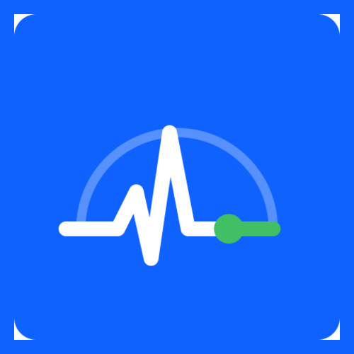
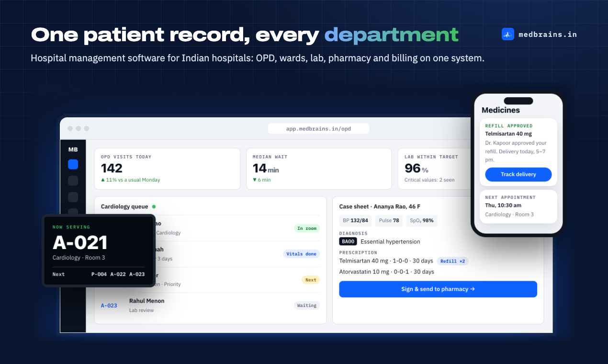

  

<h1 align="center">MedBrains</h1>

<strong>Hospital management software for Indian hospitals.</strong> 
One patient record across OPD, wards, lab, radiology, pharmacy and billing, built for ABDM, NHCX and UHI.

  <a href="https://www.medbrains.in">Website</a> ·
  <a href="https://www.medbrains.in/blog">Blog</a> ·
  <a href="https://www.medbrains.in/#demo">Book a demo</a> ·
  <a href="mailto:hello@medbrains.in">hello@medbrains.in</a>

  

## What MedBrains does

- **One patient, one record.** Registration with a duplicate check, so a patient never gets two UHIDs. The token, case sheet, orders, prescription, dispensing, bill and discharge summary all hang off that record.
- **Clinical safety in the software, not on paper.** Schedule H/H1/X and NDPS rules at the pharmacy counter, critical lab values alerted to the doctor, the WHO surgical safety checklist enforced in OT, and nursing risk scores (NEWS2, Braden, Morse).
- **The way Indian hospitals get paid.** GST billing, insurance and TPA pre-authorisation with IRDAI's 1-hour and 3-hour clocks, and UPI, card, cash and payment links.
- **Every screen in the hospital.** Web workstations, native iOS and Android apps for staff and patients, waiting-room TV token boards and kiosks.
- **Your choice of hosting.** Our cloud or your own servers. Each hospital's data is kept separate in the database, with an audit trail of who saw what.

## Roadmap

| Area | Status |
|---|---|
| Registration, OPD, IPD, nursing, lab, radiology, pharmacy, billing | ✅ In use at a hospital in Tamil Nadu |
| Native staff and patient apps (SwiftUI, Jetpack Compose) | 🟡 Built; store release in progress |
| ABDM M1: ABHA create, verify, card, QR | 🟡 Built and tested against mocks; sandbox certification next |
| ABDM M2/M3: share and fetch health records with consent | 🟡 Built; conformance fixes to NRCeS FHIR profiles in progress |
| ABDM M4: facility (HFR) and professional (HPR) registries | 🔵 In progress |
| Scan & Share at the front desk | 🟡 Built; sandbox certification next |
| NHCX insurance claims (eligibility, pre-auth, claims, payments) | 🔵 In progress: protocol conformance fixes |
| UHI provider: in-person consultations, ambulance, blood bank | 🔵 In progress |
| SNOMED CT terminology and coded clinical records | 🔵 In progress; India extensions pending licence approval |
| DPDP Act 2023 tooling: consent register, rights requests, breach register | 🟡 Built; consent enforcement next |
| Public demo hospital | 🔵 In progress |
| Redesigned interface with specialty components (dental, eye, maternity, ICU, dialysis and more) | 🔵 Design in progress |
| IVF and assisted-reproduction module (ART Act) | ⚪ Planned |

✅ live · 🟡 built, not yet certified or released · 🔵 in progress · ⚪ planned

MedBrains is **not yet certified by NHA** for ABDM, NHCX or UHI production use. We say "built for" until certification is complete.

## Source code

The source code is not public yet. We plan to release it under the **AGPL-3.0**, with a commercial licence for organisations that can't share their changes. Watch this organisation to hear when it opens.

## Get involved

We'd love to hear from **clinicians** (what slows you down?), **hospital administrators** (what does your HMS get wrong?) and **developers** (Rust, React, Swift, Kotlin). Write to hello@medbrains.in.

"MedBrains" and its logo are trademarks of the MedBrains project. SNOMED CT is a registered trademark of SNOMED International.
